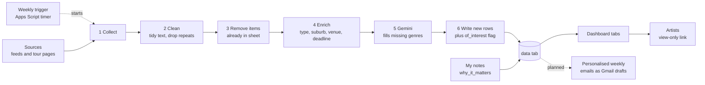

# Sydney Gigs & Opportunities Dashboard

A Google Sheet that automatically collects gigs, tours, grants, open calls and industry news relevant to Sydney artists, labels each item with a type and genre (using keywords plus Google's Gemini AI), flags what matches the genres I care about, and presents it in a filterable dashboard. Everything runs inside Google (Sheets + Apps Script) on a weekly timer. **Nothing needs to be installed on my computer.**

**Status:** Backend working, dashboard and personalised emails in progress **Owner:** Lisa Chao **Last updated:** 2026-11-09

---

## Table of Contents

1. [Purpose](#1-purpose)
2. [Project Status](#2-project-status)
3. [How It Works](#3-how-it-works)
4. [Data Model](#4-data-model)
5. [Sources](#5-sources)
6. [Google Sheet Layout](#6-google-sheet-layout)
7. [Script Files](#7-script-files)
8. [Setup From Scratch](#8-setup-from-scratch)
9. [Automation (Weekly Timer)](#9-automation-weekly-timer)
10. [Routine Maintenance](#10-routine-maintenance)
11. [Changing Settings (Quick Reference)](#11-changing-settings-quick-reference)
12. [Roadmap](#12-roadmap)
13. [Troubleshooting](#13-troubleshooting)
14. [Compliance, Privacy and Security](#14-compliance-privacy-and-security)
15. [Backup and Documentation in GitHub](#15-backup-and-documentation-in-github)
16. [Open Decisions](#16-open-decisions)
17. [Changelog](#17-changelog)

---

## 1. Purpose

Keep artists informed about where they can play, apply and network in Sydney, without anyone needing to check many websites.

**Success looks like**

- Data refreshes weekly with no manual work
- Everything links back to its original source
- Only relevant genres are surfaced (hip hop, R&B / soul, pop), while grants, open calls and industry events always show
- Each artist eventually receives a short personalised weekly email (drafted automatically with pre-specified template)

---

## 2. Project Status

| Area | Status |
| --- | --- |
| Collect from RSS and Atom feeds | Working |
| Collect from an agency tour list page (Cult Artists) | Working |
| Clean, tag type, suburb, venue, deadline (keywords) | Working (in process of implementing gemini prompts so that tour dates and locations can be accurately extracted from all forms of sources
| Genre filling with Gemini | Added |
| `of_interest` flag (yes / no / unknown) | Added |
| Write to Google Sheet with duplicate protection | Working |
| Weekly automatic run (trigger) | To set up|
| Dashboard tabs (Gigs, Opportunities, News, charts, slicers) | To build |
| Gig dates from agency tour pages | Planned |
| Take flight (source) | Planned,website currently under construction |
| Sounds Australia | Planned, check whether to include (this website shows where AU astists perform around the world)
| Personalised weekly email per artist | Planned |
| Weekly digest email | Planned |

---

## 3. How It Works



**In words:** once a week Google runs `runPipeline()`. It fetches the latest items from each source, tidies them, and skips anything already in the sheet. For the new items it works out the type (gig, grant, open call, news), suburb, venue and any deadline using keyword lists. Where no genre was found, it asks Gemini to choose from a fixed genre list. Finally it writes the new rows and marks each `yes`, `no` or `unknown` for genre interest.

| Step | What happens | Function | File |
| --- | --- | --- | --- |
| 1 | Fetch items from each enabled source | `collectAll()` | `Collectors.gs` |
| 2 | Remove HTML, shorten snippets, drop repeats and unusable items | `cleanItems()` | `Clean.gs` |
| 3 | Remove items whose ID is already in the sheet | `removeKnownItems()` | `SheetWriter.gs` |
| 4 | Type, suburb, venue, genre keywords, deadline | `enrichItems()` | `Enrich.gs` |
| 5 | Gemini fills blank genres | `addAiGenres_()` | `Gemini.gs` |
| 6 | Add new rows and the `of_interest` flag | `writeNewItems()` | `SheetWriter.gs` |
| 7 | Record the run in the `log` tab | `writeLog_()` | `SheetWriter.gs` |

`runPipeline()` in `Main.gs` runs all of these in order and is the function the timer starts.

**Golden rules**

- The Google Sheet is the master copy.
- The script writes columns A to L and P only. It never touches column M (`why_it_matters`) or the formula columns N and O.
- Items are matched by a unique `id`, so reruns never create duplicates.
- Headline, short snippet and link only. No full articles are republished.

---

## 4. Data Model

One row per item in the `data` tab.

| Col | Name | Filled by | Description |
| --- | --- | --- | --- |
| A | `id` | script | Unique code from source + link, used to spot duplicates |
| B | `title` | script | Headline or tour/event name |
| C | `type` | script | `gig`, `grant`, `open_call`, `news` (`industry_event` planned) |
| D | `event_date` | script | Date of the gig (blank until tour pages are read) |
| E | `deadline` | script | Closing date for applications |
| F | `venue` | script | Venue name from the known-venue list |
| G | `suburb` | script | Suburb from the known-suburb list |
| H | `genre` | script / Gemini | Up to 2 genres from the fixed list |
| I | `source` | script | e.g. Music Feeds, Cult Artists |
| J | `url` | script | Link to the original item |
| K | `snippet` | script | Short excerpt only |
| L | `date_collected` | script | When the script first saw it |
| M | `why_it_matters` | **me, by hand** | My personal note |
| N | `days_to_deadline` | sheet formula | Deadline minus today |
| O | `status` | sheet formula | `upcoming`, `closing_soon` (7 days or fewer), `expired` |
| P | `of_interest` | script | `yes`, `no` or `unknown` (see below) |

### The `of_interest` rule

| Value | When |
| --- | --- |
| `yes` | Type is `grant`, `open_call` or `industry_event` (always relevant), **or** the genre matches the interest list |
| `no` | Has a genre, but none of it is on the interest list |
| `unknown` | No genre could be worked out (for example, general industry news) |

Dashboards should show `yes` and `unknown` and hide `no`. Rows are **flagged, not deleted**, so nothing is lost and the script doesn't re-classify the same items every week.

---

## 5. Sources

Sources are listed in `CONFIG.SOURCES` in `Config.gs`. Source types (`kind`):

- `rss`: an RSS or Atom feed (most reliable)
- `tour_list`: a web page that lists tours as links (for agencies without feeds)

| Source | Kind | Notes | Status |
| --- | --- | --- | --- |
| Music Feeds | rss | General Australian music news | Enabled, confirm with `testFeeds` |
| Noise11 | rss | General music news | Enabled, confirm |
| Rhythms | rss | General music news | Enabled, confirm |
| The Live Wire | rss | General music news | Enabled, confirm |
| Music NSW | rss | NSW peak body, opportunities | Enabled, confirm |
| The Music Network | rss | Industry news | Enabled, confirm |
| AU Dollars | rss | Melbourne hip-hop media network | Feed address untested |
| Sounds Australia | rss | Export body, showcases and networking | Feed address untested |
| Cult Artists | tour_list | Agency upcoming tours (titles and links, no dates yet) | Added, to test |
| The Music | rss | **Blocked (HTTP 403).** Paused. Email sent or pending | Disabled |
| New World Artists | planned | Tour dates page is well structured, run `inspectAgencyPage` first | Planned |
| NewLevels | n/a | Label and management; no event list found on site | Waiting on a page to use |

**Rules for adding sources**

1. Prefer an official feed. Check the site's terms and `robots.txt`.
2. If a server returns 403, respect it. Do not disguise the script. Email the site instead.
3. Test with `testFeeds` before relying on a source.
4. Record findings (feed address, terms, quirks) in `docs/source-notes.md`.

---

## 6. Google Sheet Layout

| Tab | Purpose | Built with |
| --- | --- | --- |
| `Dashboard` | Front page: key counts, charts, slicers | Charts, slicers (to build) |
| `Gigs` | Upcoming gigs, soonest first | `QUERY` formula on `data` (to build) |
| `Opportunities` | Grants and open calls, closest deadline first | `QUERY` and conditional formatting (to build) |
| `News` | Latest headlines with links | `QUERY` (to build) |
| `data` | Master list written by the script | Script |
| `log` | Time of each run, items found, items added, errors | Script |
| `clients` | Names and emails for the digest | Typed by hand |
| `help` | "How to use this dashboard" | Typed by hand |

**Tips**

- Protect the `data` tab (Data > Protect sheets and ranges).
- Never sort the `data` tab. Sort only on dashboard tabs.
- Dashboard `QUERY` formulas should exclude `of_interest = "no"`.
- Share with "Anyone with the link" as **Viewer** only.
- Keep artist profiles, emails and personalised matches in a **separate private sheet**, because a shared link exposes every tab.

---

## 7. Script Files

All files live in one Apps Script project (Extensions > Apps Script inside the sheet).

| File | Job | Main functions |
| --- | --- | --- |
| `Config.gs` | All settings in one place | `CONFIG` (sources, tab names, keyword lists, Gemini settings, interest genres) |
| `Collectors.gs` | Fetch from sources | `collectAll`, `collectFeed_`, `collectTourList_`, `testCollector`, `testFeeds`, `inspectAgencyPage` |
| `Clean.gs` | Tidy text | `cleanItems`, `tidyText_`, `formatDate_`, `testClean` |
| `Enrich.gs` | Keyword labelling | `enrichItems`, `guessType_`, `findDeadline_`, `interestFlag_`, `testEnrich` |
| `Gemini.gs` | AI genre filling | `addAiGenres_`, `listGeminiModels`, `checkGeminiKey`, `testGemini`, `backfillGenres` |
| `SheetWriter.gs` | Read and write the sheet | `writeNewItems`, `removeKnownItems`, `writeLog_`, `setupDataTab`, `refreshInterestColumn` |
| `Main.gs` | Run everything | `runPipeline` |
| `Digest.gs` | Weekly emails | Planned |

**How to run a function:** pick it in the dropdown next to **Run** at the top of the editor, then click **Run**. Running also saves the project. Click inside a file first if Cmd+S downloads a web page instead of saving.

---

## 8. Setup From Scratch

Follow in order. Tick as you go.

### A. The sheet

- [ ] Create a Google Sheet (use a dedicated Google account if possible).
- [ ] Create tabs: `data`, `log`, `clients`, `help`, plus dashboard tabs later.
- [ ] Open **Extensions > Apps Script** and rename the project.

### B. The code

- [ ] Create the script files in section 7 (**+** next to "Files" > **Script**; Apps Script adds `.gs`).
- [ ] Paste the backed-up code into each file.
- [ ] Run any function once to save.

### C. Permissions

- [ ] On the first run, click **Review permissions**, choose your account, **Advanced**, **Go to (project) (unsafe)**, **Allow**. This is normal for your own scripts.

### D. Gemini

- [ ] Go to **aistudio.google.com/apikey** and click **Create API key** (not "Get code").
- [ ] In Apps Script open **Project Settings** (gear), scroll to **Script Properties**, add `GEMINI_API_KEY` with the key, and save.
- [ ] Run `checkGeminiKey`. Expect a length around 39, starting `AIza`, and `false` for both spaces and quote marks.
- [ ] Run `listGeminiModels` and put a current **flash** or **flash-lite** name into `CONFIG.GEMINI.MODEL`.
- [ ] Run `testGemini`.

### E. First data run

Run these in order, checking the log after each:

1. [ ] `testFeeds`: which sources respond? Disable any that return 403, 404 or FAILED.
2. [ ] `testCollector`: items found per source.
3. [ ] `setupDataTab`: writes headers and formulas to the `data` tab (safe to rerun).
4. [ ] `refreshInterestColumn`: adds the `of_interest` header in column P.
5. [ ] `runPipeline`: should end `Done. Found N, added N new.`
6. [ ] `runPipeline` again: should say `added 0` (proves duplicate protection works).
7. [ ] `backfillGenres`: fills genres for any rows that were written without one.

If a run is cut off at the 6-minute limit, run `backfillGenres` again. It continues where it left off.

---

## 9. Automation (Weekly Timer)

### A. Set the time zone

- [ ] **Project Settings** (gear icon): confirm the time zone is **Sydney** (Australia/Sydney). If there's no time zone box, tick **Show "appsscript.json" manifest file**, open that file, and set `"timeZone": "Australia/Sydney"`.

### B. Create the weekly trigger

- [ ] Click the **clock icon** (Triggers) in the left sidebar.
- [ ] Click **Add Trigger** (bottom right).
- [ ] Function to run: **`runPipeline`**
- [ ] Deployment: **Head**
- [ ] Event source: **Time-driven**
- [ ] Type: **Week timer**
- [ ] Day: for example **Every Monday**; time: for example **6am to 7am**
- [ ] Failure notification settings: **Notify me immediately**
- [ ] Save, and approve permissions if asked.

### C. Confirm it worked by itself

- [ ] The following Monday, open the `log` tab and look for a new line you didn't start.
- [ ] Or open **Executions** in the left sidebar and check for a run triggered by "Time-driven".

### D. Later triggers

| Function | When | Status |
| --- | --- | --- |
| `runPipeline` | Weekly, e.g. Monday 6am | Set up in this section |
| Weekly digest | One hour after the pipeline | Planned |
| Personalised artist drafts | One hour after the pipeline | Planned |

---

## 10. Routine Maintenance

### Every week (about 10 minutes)

- [ ] Open the `log` tab. The latest line should say `OK` with a reasonable number of new items. If it says `ERROR` or `No items collected`, see section 13.
- [ ] Skim new rows in `data`. Fix wrong `type`, `suburb` or `genre` by hand (the script won't overwrite your edits).
- [ ] After editing genres by hand, run `refreshInterestColumn` so `of_interest` stays correct.
- [ ] Add `why_it_matters` notes to the most relevant items.
- [ ] Check the dashboard link still opens in a private browser window.

### Every month

- [ ] Run `testFeeds` and check each source still responds. Disable or replace dead ones.
- [ ] Run `listGeminiModels` and make sure `CONFIG.GEMINI.MODEL` is still listed (model names get retired).
- [ ] Check the Executions page for failed or slow runs.
- [ ] Back up the code to GitHub (section 15) and add a line to the changelog.
- [ ] Review wrong labels you corrected, and add the missing keywords, suburbs or venues to `Config.gs`.

### Every quarter

- [ ] Review the source list: add useful new ones, drop low-value ones.
- [ ] Check each source's terms of use and your permission emails.
- [ ] Review `INTEREST_GENRES` against your current roster.
- [ ] Replace the Gemini API key (create a new one in AI Studio, update Script Properties, delete the old one).
- [ ] Check the free-tier limits and terms for Gemini and Apps Script.

### Every year

- [ ] Archive old rows: copy last year's `data` rows into an `archive` sheet and delete them from `data` (keep the formulas in row 2).
- [ ] Review who has access to the sheet and the script.

---

## 11. Changing Settings (Quick Reference)

| I want to... | Do this |
| --- | --- |
| Add a feed source | Add a block to `SOURCES` in `Config.gs` with `kind: 'rss'`, run `testFeeds` |
| Pause a source | Set `enabled: false` for it |
| Change the genres I care about | Edit `INTEREST_GENRES` (names must match `GEMINI.GENRES`), then run `refreshInterestColumn` |
| Add a genre | Add it to `GEMINI.GENRES` in `Config.gs` (and to `INTEREST_GENRES` if wanted) |
| Add suburbs or venues | Add to `SUBURBS` or `VENUES` |
| Add words that identify a type | Edit `TYPE_KEYWORDS` |
| Change the Gemini model | Update `GEMINI.MODEL` after running `listGeminiModels` |
| Change the schedule | Clock icon > edit the trigger |
| Change how many items per source | Edit `MAX_ITEMS_PER_SOURCE` |
| Turn Gemini off | Set `GEMINI.ENABLED: false` |

---

## 12. Roadmap

### Next up

- [ ] **Run the new Cult Artists source** and check the results.
- [ ] **Read dates from agency tour pages.** Cult Artists lists tours without dates, so the next step is opening each tour page (a page per tour) and extracting NSW dates and venues, probably with Gemini plus spot checks.
- [ ] **New World Artists:** run `inspectAgencyPage`, then build a collector for its Tour Dates page (state filter, 5 pages).
- [ ] **Add an `industry_event` type** (showcases, conferences, industry nights, workshops, panels) to answer "where can my artists network".
- [ ] **Build the dashboard tabs** (This Week, Gigs, Opportunities, Networking, News) with slicers, charts and a "closing soon" flag.

### Personalised artist emails (planned)

1. Private sheet with one profile per artist: genres, home suburb, career stage, what they're looking for, email.
2. Score each week's items per artist (genre fit, Sydney location, type fit, deadline urgency, newness).
3. Gemini writes a one-line "why this fits you" for each artist's top picks (one request per artist per week; send minimal fields only).
4. The script saves one **Gmail draft** per artist. I review and press send.
5. Optionally a monthly one-page brief per artist.

### Later

- Weekly digest email for all artists
- Calendar (ICS) feed of gigs
- Looker Studio dashboard on top of the same sheet, if the sheet feels too plain

---

## 13. Troubleshooting

| Problem | Likely cause | What to try |
| --- | --- | --- |
| "Attempted to execute myFunction, but it was deleted" | The Run dropdown still points at an old function | Reload the page and choose a function from the dropdown |
| Run button is gray | The open file contains no runnable functions (for example `Config.gs`) | Open another file such as `Main.gs` or `Collectors.gs` |
| Cmd+S downloads a web page | Keyboard focus is outside the code editor | Click inside the code first, or just run a function (it saves) |
| `ReferenceError: X is not defined` | The function is missing, not saved, or was pasted **inside** another function | Paste new functions below the last closing `}` of a file, on their own, and check the file is saved |
| `HTTP 403` from a source | The site blocks automated requests | Don't work around it. Disable the source and email the site |
| `HTTP 404` from a feed | Wrong or retired feed address | Check the address in a browser, then update `Config.gs` |
| `found 0 items` | Feed loaded but empty, or `enabled` is false | Check `enabled`, open the feed in a browser |
| Gemini: `API key not valid` (HTTP 400) | Wrong value in Script Properties | Run `checkGeminiKey`. Re-paste only the short `AIza...` key from the API keys page, not the "Get code" sample |
| Gemini: model not found (HTTP 404) | Model name retired | Run `listGeminiModels` and update `GEMINI.MODEL` |
| Gemini: `HTTP 429` | Free-tier rate limit | The script retries once. Raise `PAUSE_MS`, lower `BATCH_SIZE`, or try later |
| Gemini returns nothing | Missing key or Gemini turned off | Check the log for "Gemini skipped" |
| `Tab "data" not found` | Tab name doesn't match `Config.gs` | Fix capitals and spaces |
| `Exceeded maximum execution time` | Run longer than about 6 minutes | Run again (it resumes), disable a slow source, or split the work |
| Second run adds rows again | IDs are inconsistent | Check `makeId_` is unchanged and nobody sorted or edited column A |
| Notes shifted onto wrong rows | `data` tab was sorted | Never sort `data`. Sort dashboard tabs instead |
| Permission screen blocks | Wrong Google account | Use the account that owns the sheet |
| `of_interest` column empty | Header not set up | Run `refreshInterestColumn` |

**Tip:** the error message nearly always names the missing function or the failing source. Copy the exact text when asking for help.

---

## 14. Compliance, Privacy and Security

**Content**

- Store headline, short snippet and link only. Always credit the source and link back.
- Prefer feeds to scraping. Check each site's terms and `robots.txt`.
- If a site blocks the script, respect it. Ask permission instead.
- Collect gently: once a week is enough.
- Email agencies and publishers whose content you list. Most welcome the exposure.

**Privacy**

- Do not collect personal data about members of the public.
- Keep artist profiles, emails and personalised matches in a **separate private sheet**, never in the shared dashboard sheet.
- The `clients` tab must never be shared.
- Free-tier Gemini content may be used by Google to improve its products. Send only public headlines and snippets, and minimal artist fields (genres, goals, themes). Review Google's current terms before sending anything sensitive.

**Security**

- The Gemini key lives only in **Script Properties**. Never put it in code, in this repo or in chat.
- Give viewers **View** access only.
- Review sheet and script access every year.
- Use a dedicated Google account for the project if Gmail drafts are added, since that permission is broad.

---

## 15. Backup and Documentation in GitHub

GitHub is for **notes and backup only**. No code runs there, and nothing needs installing.

```
sydney-gigs-dashboard/
├── README.md                 # this file
├── docs/
│   ├── source-notes.md       # per source: feed address, terms, permission emails, quirks
│   └── client-guide.md       # artist-facing how-to
└── apps-script-backup/
    ├── Config.gs
    ├── Collectors.gs
    ├── Clean.gs
    ├── Enrich.gs
    ├── Gemini.gs
    ├── SheetWriter.gs
    ├── Main.gs
    └── Digest.gs             # when built
```

**How to back up (no software needed)**

1. In Apps Script, open a file, click in the code and select all (Cmd+A), then copy.
2. On GitHub, open the repo and click **Add file > Create new file**. Name it, for example `apps-script-backup/Collectors.gs`, paste, and click **Commit changes**.
3. Repeat for each changed file. Add a line to the changelog.

**Never paste API keys, passwords or private email lists into GitHub.** Keep the repo private if unsure.

---

## 16. Open Decisions

| Question | Options | Decision |
| --- | --- | --- |
| Run day and time | e.g. Monday 6am Sydney time | *TBC* |
| Permission from The Music | Email sent? Reply? | *TBC* |
| Permission from agencies | Email Cult Artists, New World Artists | *TBC* |
| Which NewLevels page to use | News, events or artists page | *TBC* |
| Dashboard style | Google Sheets only / Looker Studio later | *TBC* |
| Personalised emails | Gmail drafts / email to myself | *TBC* |
| Gemini tier | Free / paid (data-use terms) | *TBC* |
| Repo visibility | Private / public | *TBC* (private suggested) |

---

## 17. Changelog

| Date | Change |
| --- | --- |
| 2026-11-04 | Project planned, README created |
| 2026-11-04 | Moved from Excel to Google Sheets, then to Google Apps Script (no local installs) |
| 2026-11-04 | Built Config, Collectors, Clean, Enrich, SheetWriter and Main; data flowing into the sheet |
| 2026-11-09 | Added Gemini genre filling and the `of_interest` flag (column P) |
| 2026-11-09 | Added Cult Artists (tour list source); researched New World Artists, AU Dollars and NewLevels |
| 2026-11-09 | README rewritten with full pipeline, automation steps and maintenance routine |
